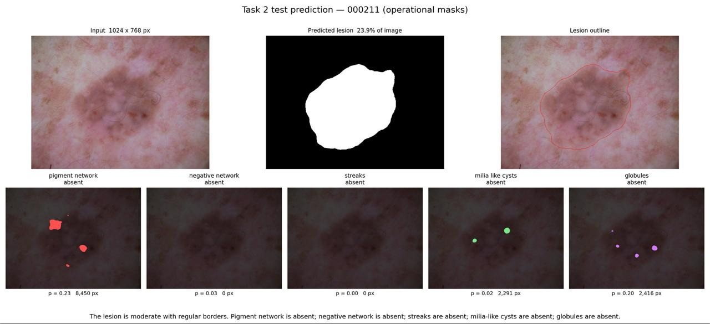
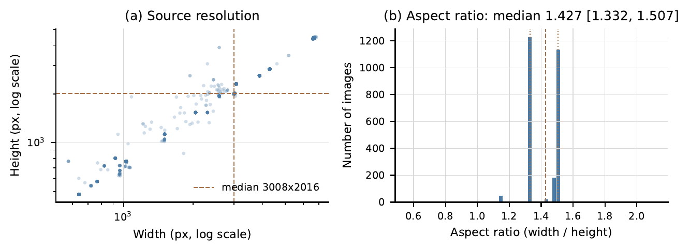
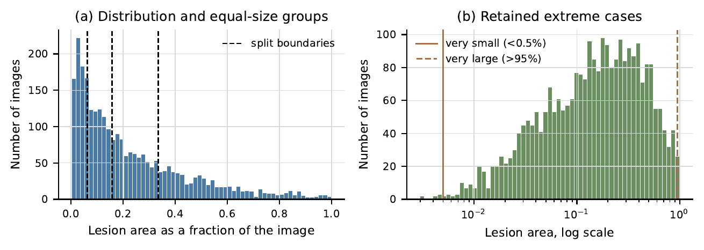
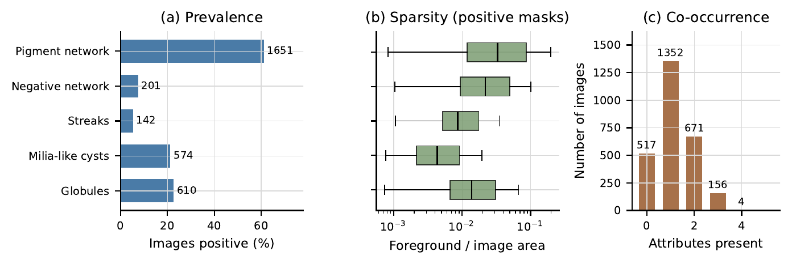
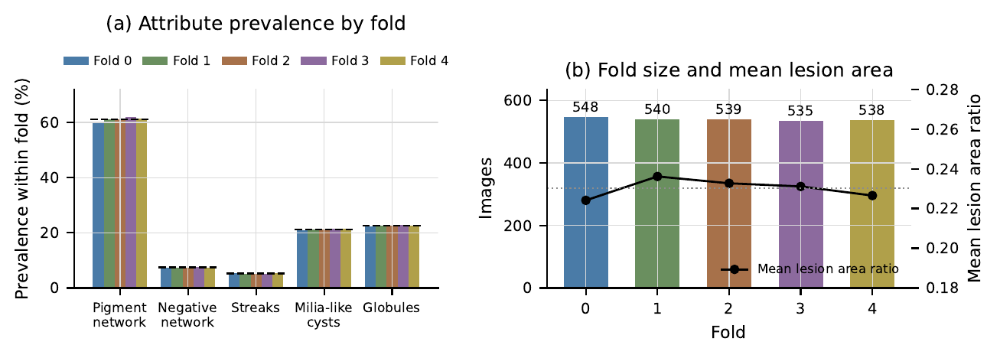
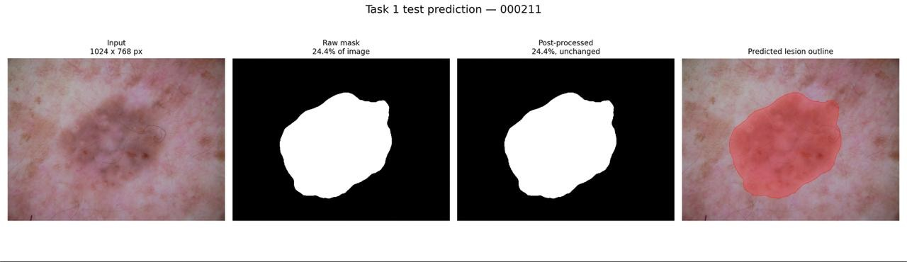
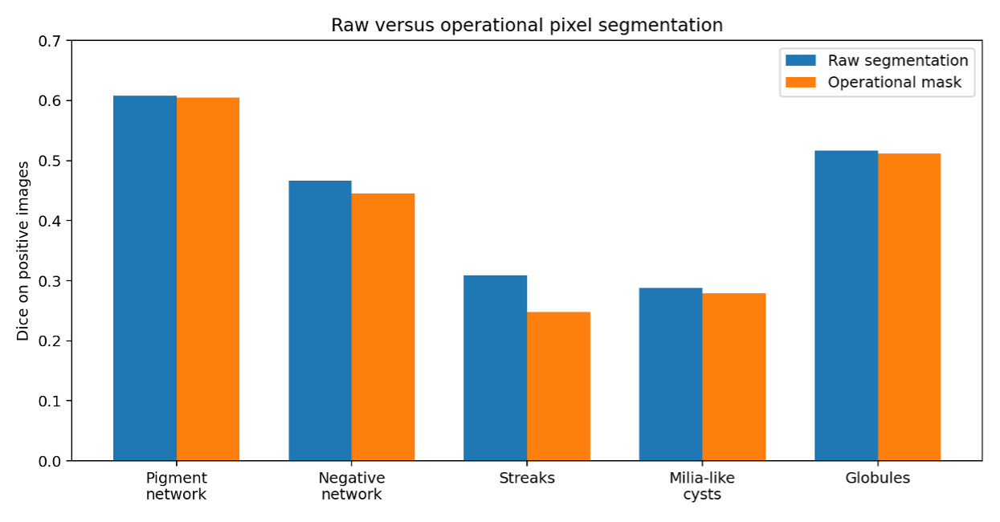
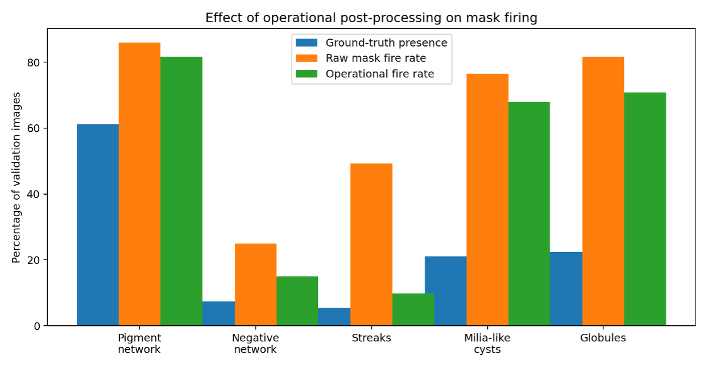

# Automated Dermoscopic Lesion Analysis & Diagnostic Pipeline

Imperial College London — Data Science & AI Summer School, group project (July 2026)

An end-to-end deep-learning pipeline that turns a raw dermoscopic image into a structured, auditable clinical findings report: lesion segmentation → dermoscopic attribute detection → rule-based report generation, with an optional CLIP retrieval step that attaches visual context to uncertain findings.

**Team:** Dildora Kadirova · Jianxiong Zhao · Manuela Daros Misurelli · Mohammed Alrabiah · Remy Maurel · Sirong Huang



---

## Pipeline

```
dermoscopic image
   │
   ▼
Task 1 ── ResNet-34 U-Net ──────────► lesion mask
   │
   ▼  crop to predicted lesion box (+25 % margin), resize 512×512
Task 2 ── ResNet-34 U-Net (5 heads) ► 5 attribute masks + presence probabilities
   │
   ▼  geometry + thresholds + evidence audit
Task 3 ── rubric ───────────────────► JSON + controlled-text report
   │
   ▼  (bonus) CLIP ViT-B/32 retrieval over training crops
         └──────────────────────────► retrieval-based prior / report context
```

### Task 1 — Lesion segmentation
- U-Net decoder with an ImageNet-pretrained ResNet-34 encoder (`segmentation_models_pytorch`), single-channel output, 384 × 384 input.
- BCE + soft-Dice loss, AdamW (LR 1e-4), `ReduceLROnPlateau` on validation Dice, early stopping; batch size 8, up to 35 epochs.
- Evaluated with Dice, IoU, HD95 and the official ISIC *thresholded Jaccard* (per-image Jaccard zeroed below 0.65), so the headline number reflects the failure rate instead of hiding it behind a good average.

### Task 2 — Attribute detection
Five independent binary segmentation problems (pigment network, negative network, streaks, milia-like cysts, globules) sharing one encoder, initialised from the trained Task 1 encoder, plus an auxiliary classification head that predicts one presence probability per attribute.

**Why crops.** A first version trained on whole images at 384 px handled pigment network but failed almost completely on the sparse attributes. The cause was resolution, not optimisation: a milia-like cyst spans ~10 px in the original image and ~4 px after resizing, and the encoder downsamples by 32×, so it all but vanishes. The pipeline was rebuilt around lesion crops — a box around the *predicted* Task 1 lesion (never the ground-truth mask, to avoid label leakage), enlarged by 25 % (randomised between 18 % and 30 % with slight jitter during training), cut from the full-resolution image and resized to 512 px. The same cyst now arrives ~13 px across, and 99.1–100 % of annotated attribute pixels survive the crop.

**Attribute-specific losses.** clDice for the thin, network-like attributes, focal BCE for the blob-like ones, Dice for all. The Dice term is computed on positive images only, so the many empty masks can't reward predicting nothing; positive-pixel weights use square-root inverse frequency, and images with rare attributes are oversampled.

| Attribute | Loss |
|---|---|
| Pigment network | 35 % weighted BCE + 65 % Dice |
| Negative network | 30 % weighted BCE + 50 % Dice + 20 % soft clDice |
| Streaks | 25 % weighted BCE + 45 % Dice + 30 % soft clDice |
| Milia-like cysts | 50 % focal BCE + 50 % Dice |
| Globules | 40 % focal BCE + 60 % Dice |

**Operational post-processing** for the report-facing masks:
- *Soft classification gating* — the presence head scales mask probabilities down rather than erasing them, because an erased mask scores zero on every image that does contain the attribute.
- *Soft ROI suppression* — probabilities outside a dilated Task 1 lesion region are multiplied by 0.25 instead of zeroed.
- *Connected-component filtering* — components below attribute-specific minimum areas are removed after thresholding.

Training: AdamW, up to 30 epochs, batch 4 with 2-step gradient accumulation (effective batch 8), LR 1e-4, weight decay 1e-4, gradient clipping at 1.0, auxiliary classification loss weight 0.20. Two checkpoints are kept — best mask overlap (for masks) and best combined overlap + presence accuracy (for the probabilities Task 3 uses). Per-attribute thresholds are tuned on the held-out fold, and predictions are averaged over horizontal/vertical flips.

### Task 3 — Anchored findings report
A pure-geometry, torch-free rubric (`step19_task3_rubric.py`) shared by the report generator and the visualiser, so the two can never drift apart. The same structured fields produce both the JSON record and the natural-language text.

| Field | Rule |
|---|---|
| Size | `lesion_px / total_px`: small < 0.08, moderate 0.08–0.25, large > 0.25 |
| Border | compactness index `P² / (4πA)`; irregular if ≥ 1.60 |
| Attribute status | present if p ≥ 0.60, absent if p ≤ 0.40, otherwise uncertain |
| Evidence audit | a "present" finding needs ≥ 20 mask pixels inside the Task 1 lesion region |

The evidence audit flags inconsistencies between the classification and segmentation outputs but never silently changes a Task 2 status.

### Bonus — CLIP retrieval
`step22_bonus.py` embeds each predicted lesion crop with a frozen CLIP ViT-B/32 encoder (`openai/clip-vit-base-patch32`, 512-D) and retrieves the top-5 most similar crops by cosine similarity from a reference index built from the training folds only (the validation fold is query-only; self-matches are excluded and audited). The neighbours' attribute labels form a weak prior that is blended into the Task 2 presence probability (α = 0.20), but only where Task 2 is undecided (0.25 < p < 0.75), so retrieval can stabilise an estimate but never supply a finding on its own. The script evaluates Task 2 alone, retrieval alone and the fused probabilities side by side.

Fusion did not improve validation performance (retrieval-only macro F1 0.437 vs Task 2 baseline 0.654), so the team's final report used retrieval purely as *context*: each finding was labelled supportive, conflicting, informative, mixed or insufficient relative to the unchanged Task 2 status. That context-only variant and its test-set deployment are not included in this repository.

---

## Data

2,700 dermoscopic images, each with one lesion mask and five attribute masks (13,500 attribute masks). Attributes are not mutually exclusive — an image can show several or none.

**Quality control.** An automated suite (`run_all_automatic_qc.py`) checked readability and RGB format, image–mask size agreement across all 16,200 pairs, mask binarity, missing pairs and duplicate images — everything passed. Edge cases were flagged but deliberately **kept** as genuine, clinically realistic difficulty: one lesion filling the entire image, 7 very small lesions (< 0.5 % of the image), 16 very large (> 95 %), and 264 (9.8 %) touching the image edge.

**Image size.** Resolutions range from under 600 to nearly 6,900 px wide, but aspect ratios sit in a narrow band, so images can be resized to a common size without distortion: aspect-preserving resize and padding to 384 × 384, nearest-neighbour interpolation for masks.



**Lesion size** is heavily skewed — most lesions are small relative to the image and a minority fill most of the frame. Small lesions are harder to segment, so sizes must be spread evenly across the split.



**Attributes** are imbalanced in both frequency and area: pigment network appears in 61 % of images, streaks in 5 %, and when present most attributes cover only a few percent of the image. Most images contain one or two attributes; 517 contain none and none contain all five. A model could score a deceptively low error by predicting "absent" everywhere — the Task 2 training design exists to prevent that.

| Attribute | Images | Share | Typical area when present |
|---|---|---|---|
| Pigment network | 1,651 | 61.1 % | 3.3 % |
| Globules | 610 | 22.6 % | 1.4 % |
| Milia-like cysts | 574 | 21.3 % | 0.4 % |
| Negative network | 201 | 7.4 % | 2.2 % |
| Streaks | 142 | 5.3 % | 0.9 % |



**Splitting.** `step11_split.py` assigns images to five deterministic folds with `MultilabelStratifiedKFold` (seed 42), stratifying on the presence of each attribute, no-attribute and multiple-attribute status, and lesion-area quartile; images with identical hashes would be kept in the same fold. Fold 0 (548 images) is the development validation fold and folds 1–4 (2,152 images) are used for training. Image and masks are always transformed together: Task 1 training uses random flips and a mild affine transform (±15° rotation, shift, scale); Task 2 adds light colour jitter and retries any augmentation that would erase a small positive mask. Validation preprocessing is deterministic.



---

## Results

The numbers below are from the team's final training run, as reported in the project report. Two caveats for anyone reproducing them:

- That run validated on 540 images (2,160 training), while the fold file committed in `splits/` gives 548 / 2,152, so re-running the scripts reproduces the method but not the exact figures.
- Test-set inference (893 images, labels withheld) — the Task 3 test reports, the two test-prediction figures and the test retrieval statistics — was run with code that is not included here; the scripts in this repository operate on the validation fold.

### Task 1 — lesion segmentation

| Dice (± std) | IoU | Thresholded Jaccard | HD95 (384 px) | Failures (IoU < 0.65) |
|---|---|---|---|---|
| **0.901 ± 0.109** | 0.834 | 0.791 | 16.96 px | 9.1 % (49 / 540) |

Validation Dice climbed from 0.844 to 0.889 within four epochs thanks to the pretrained encoder, plateaued around 0.88–0.90, then reached its peak of 0.901 at epoch 22 after the scheduler halved the learning rate to 5e-5. Validation loss started rising afterwards while training loss kept falling, and early stopping ended the run at epoch 30. Failures concentrate on extreme aspect ratios, low lesion–skin contrast and heavy artefacts such as hair and reflections.



### Task 2 — attribute detection

Raw = model output after TTA and threshold tuning; operational = after post-processing. Dice is computed on images where the attribute is present, and within lesion crops — so it is not directly comparable to whole-image numbers.

| Attribute | Raw Dice | Raw IoU | Oper. Dice | Mask F1 | Presence P / R | Presence F1 |
|---|---|---|---|---|---|---|
| Pigment network | 0.608 | 0.471 | 0.605 | 0.848 | 0.856 / 0.921 | 0.888 |
| Negative network | 0.466 | 0.336 | 0.445 | 0.562 | 0.675 / 0.675 | 0.675 |
| Streaks | 0.309 | 0.204 | 0.248 | 0.488 | 0.577 / 0.517 | 0.546 |
| Milia-like cysts | 0.288 | 0.180 | 0.279 | 0.442 | 0.520 / 0.561 | 0.540 |
| Globules | 0.516 | 0.374 | 0.511 | 0.464 | 0.650 / 0.736 | 0.690 |
| **Macro** | **0.438** | 0.313 | 0.418 | **0.561** | – | **0.668** |

Pigment network is the strongest attribute for both segmentation and classification; streaks and milia-like cysts remain hardest because they are rare and spatially tiny. Post-processing costs about 0.02 macro Dice but raises macro mask-presence F1 from 0.457 to 0.561 by sharply reducing masks that fire on images where the attribute is absent.

<p align="center">
  
  
</p>

### Task 3 — reporting (893-image test set)

| Check | Result |
|---|---|
| Reports generated, all five attributes present, valid schema | 893 / 893 |
| JSON statuses agree with report text | 893 / 893 |
| Present findings backed by ≥ 20 lesion-region mask pixels | 880 / 893 (98.5 %) |
| Reports flagged for review | 13 / 893 (1.5 %) |

All 13 flagged reports failed only the mask-evidence check. Predicted status distributions follow the expected pattern — pigment network present in 55 % of reports, negative network and streaks absent in over 93 %.

### Bonus — retrieval context (final context-only variant)

| | Validation | Test |
|---|---|---|
| Query images | 540 | 893 |
| Mean top-1 cosine similarity | 0.948 | 0.946 |
| Supportive / conflicting context | 55.1 % / 7.0 % | 54.0 % / 7.5 % |
| Mixed / insufficient context | 31.0 % / 5.0 % | 30.7 % / 6.2 % |
| Uncertain findings given informative context | 52 / 107 (48.6 %) | 75 / 213 (35.2 %) |
| Integrity checks | passed | passed |

Validation and test distributions match closely, so the frozen thresholds transferred stably.

---

## Repository layout

```
Images/                      # pipeline scripts, numbered in execution order
  qc_config.py, qc_utils.py  # paths, attribute order, shared helpers
  step00–step10              # dataset organisation, index CSV, automated QC
  step11_split.py            # multilabel-stratified 5-fold split
  step12_data_augmentation.py# LesionDataset + torchvision v2 transforms
  step13_visualize_augmentations.py
  step14_task1_training.py   # Task 1 model definition (smp U-Net / ResNet-34)
  step15_train.py            # Task 1 training loop, metrics, resume
  step16_train_visualisation.py  # Task 1 error analysis, threshold sweep, worst cases
  step17_task2_training.py   # Task 2 model definition (5 heads + classification head, Task 1 encoder warm-start)
  step18_train.py            # Task 2 first version: whole image at 384 px, Tversky loss, hard gating
  step18b_train_better.py    # Task 2 final version: 512 px lesion crops, attribute-specific losses, soft gating
  step19_task3_rubric.py     # Task 3 thresholds and phrasing (torch-free)
  step20_task3_report.py     # Task 3 inference cache, per-image JSON, CSV summary, audit
  step21_visualize.py        # end-to-end figure per image
  step22_bonus.py            # CLIP retrieval with gated probability fusion
  fig01–fig04                # scripts for the dataset figures (dimensions, attributes, folds, lesion area)
index.csv, labels.csv        # dataset index and per-image attribute labels
splits/                      # fold assignments and balance summaries
docs/figures/                # figures used in this README
```

## Running it

Requires Python 3.10+ (developed on 3.11) and PyTorch. Install the dependencies:

```bash
pip install torch torchvision segmentation-models-pytorch transformers \
            iterative-stratification numpy pandas scipy opencv-python pillow matplotlib
```

The dataset itself is not included. Place it under `data/` in the layout expected by `index.csv` (`step00_organize_task2_masks.py` sorts the raw Task 2 masks into per-attribute folders; see `qc_config.py` for paths). `index.csv` and the fold assignments in `splits/` are already committed. Then, from inside `Images/`:

```bash
cd Images
python run_all_automatic_qc.py      # automated checks: steps 02–07 and 10
python step08_check_img_mask_overlay.py        # manual overlay review
python step09_check_attribute_mask_overlay.py  # manual overlay review
python step11_split.py              # optional: regenerates splits/
python step15_train.py              # Task 1
python step18b_train_better.py      # Task 2 (needs the Task 1 checkpoint)
python step20_task3_report.py       # Task 3 on the validation fold
python step21_visualize.py
python step22_bonus.py              # optional
```

The scripts select CUDA, then Apple-silicon MPS, then CPU; the reported models were trained on MPS. Task 2 inference over the validation fold takes 15–20 minutes and is cached under `outputs/task3_reports/task2_cache/`, so re-running the report takes seconds.

## Future work

- **Robustness:** full five-fold cross-validation with confidence intervals (the fold assignments already support it), external-cohort evaluation, and failure analysis stratified by lesion size, contrast, border complexity and artefacts.
- **Task 1:** controlled ablations of hair removal, colour constancy and reflection suppression; comparison against UNet++, DeepLabV3+, FPN and hybrid transformers under the same protocol.
- **Task 2:** multiscale supervision and patch-based refinement for streaks and milia-like cysts, better probability calibration, systematic ablation of each pipeline component, and learnable gate strengths instead of hand-set ones.
- **Task 3 & retrieval:** validate reports against expert-reviewed findings, calibrate the 20-pixel evidence rule, and replace generic CLIP features with dermoscopy-specific embeddings that retrieve local attribute regions.

## References

Ronneberger et al. 2015 (U-Net) · Long et al. 2015 (FCN) · Yuan et al. 2017 (Jaccard loss) · Abraham & Khan 2019 (Focal Tversky) · Oktay et al. 2018 (Attention U-Net) · Zhou et al. 2018 (UNet++) · Isensee et al. 2021 (nnU-Net) · Radford et al. 2021 (CLIP)
