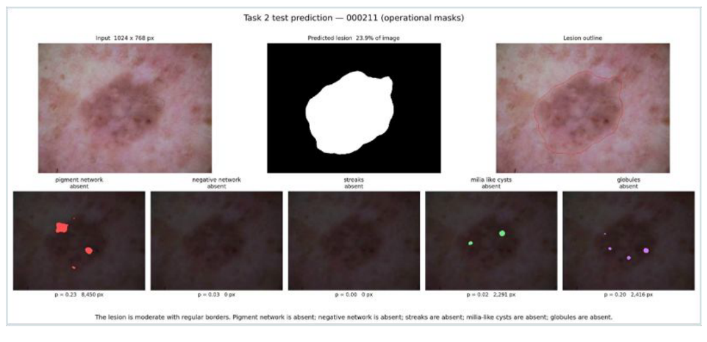
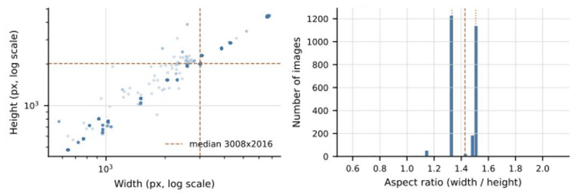
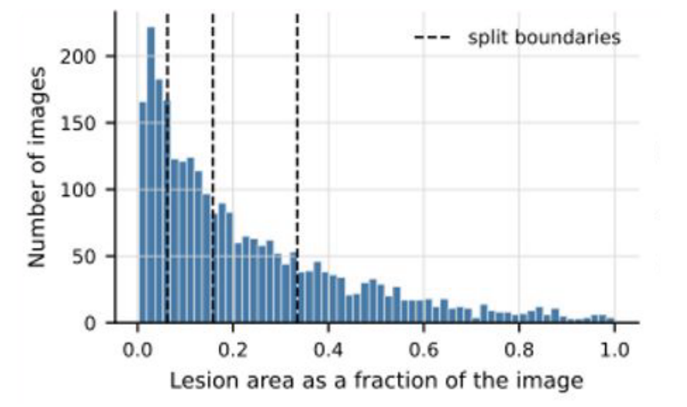
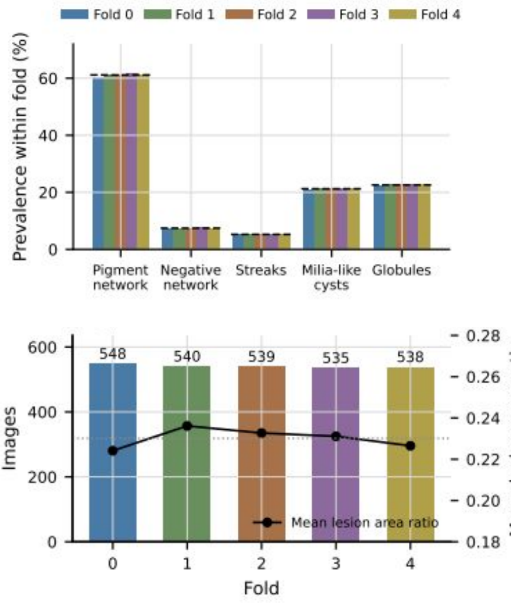
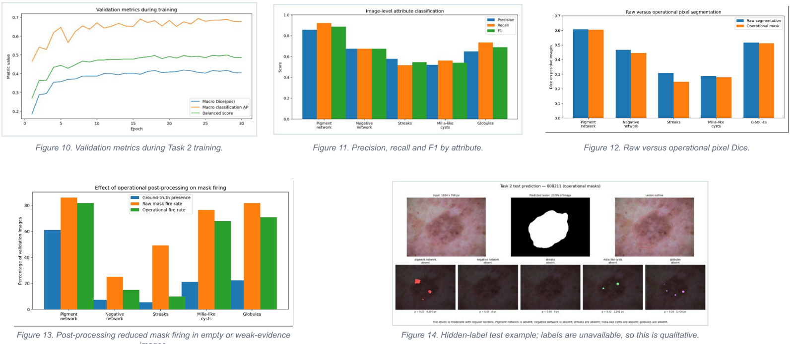

# Automated Dermoscopic Lesion Analysis & Diagnostic Pipeline

Imperial College London — Data Science & AI Summer School, group project (July 2026)

An end-to-end deep-learning pipeline that turns a raw dermoscopic image into a structured, auditable clinical findings report: lesion segmentation → dermoscopic attribute detection → rule-based report generation, with an optional CLIP retrieval step that adds contextual evidence for uncertain findings.

**Team:** Dildora Kadirova · Jianxiong Zhao · Manuela Daros Misurelli · Mohammed Alrabiah · Remy Maurel · Sirong Huang



---

## Pipeline

```
dermoscopic image
   │
   ▼
Task 1 ── ResNet-34 U-Net ──────────► lesion mask
   │
   ▼  crop to predicted lesion box (+margin), resize 512×512
Task 2 ── ResNet-34 U-Net (5 heads) ► 5 attribute masks + presence probabilities
   │
   ▼  geometry + thresholds + evidence audit
Task 3 ── rubric ───────────────────► JSON + controlled-text report
   │
   ▼  (bonus) CLIP ViT-B/32 retrieval over training crops
         └──────────────────────────► supportive / conflicting / mixed context label
```

### Task 1 — Lesion segmentation
- U-Net decoder with an ImageNet-pretrained ResNet-34 encoder (`segmentation_models_pytorch`), single-channel output, 384 × 384 input.
- BCE + soft-Dice loss, AdamW, LR 1e-4 with scheduling, 35 epochs max, early stopping and checkpoint selection on the held-out fold.
- Evaluated with Dice, IoU, HD95 and the official ISIC *thresholded Jaccard* (per-image Jaccard zeroed below 0.65), so the headline number tracks the failure rate rather than hiding it.

### Task 2 — Attribute detection
Five independent binary segmentation problems sharing one encoder (pigment network, negative network, streaks, milia-like cysts, globules), plus an auxiliary classification head on the encoder bottleneck that gives one presence probability per attribute.

The rare, tiny attributes (streaks, milia-like cysts) scored ~0.1 Dice at 384 px whole-image resolution. The fix was resolution, not tuning:

- **Crop-then-resize.** Crop to the *predicted* Task 1 lesion box (never the ground-truth mask, to avoid label leakage), resize to 512 × 512. This preserved 99.1–100 % of labelled attribute pixels while giving small structures several times more pixels.
- **Attribute-specific losses.** clDice for the curvilinear attributes (negative network, streaks), focal BCE for the blob-like ones (milia-like cysts, globules), Dice everywhere:

  | Attribute | Loss |
  |---|---|
  | Pigment network | 35 % weighted BCE + 65 % Dice |
  | Negative network | 30 % weighted BCE + 50 % Dice + 20 % soft clDice |
  | Streaks | 25 % weighted BCE + 45 % Dice + 30 % soft clDice |
  | Milia-like cysts | 50 % focal BCE + 50 % Dice |
  | Globules | 40 % focal BCE + 60 % Dice |

- **Soft post-processing** for the report-facing "operational" masks: classification gating *scales* mask probabilities rather than zeroing them, probabilities outside the dilated lesion region are multiplied by 0.25, and small connected components below attribute-specific minimum areas are removed.
- Horizontal/vertical test-time augmentation at inference.

### Task 3 — Anchored findings report
A pure-geometry, torch-free rubric (`step19_task3_rubric.py`) so the report generator and the visualiser can never drift apart:

| Field | Rule |
|---|---|
| Size | `lesion_px / total_px`: small < 0.08, moderate 0.08–0.25, large > 0.25 |
| Border | irregularity index `P² / (4πA)`; irregular if ≥ 1.60 |
| Attribute status | present if p ≥ 0.60, absent if p ≤ 0.40, otherwise uncertain |
| Evidence flag | a "present" finding needs ≥ 20 mask pixels inside the Task 1 lesion region |

The evidence audit flags inconsistencies but never silently edits a Task 2 status. Output is a JSON record per image plus controlled natural-language text.

### Bonus — CLIP retrieval context
Lesion crops are embedded with CLIP ViT-B/32 and matched (cosine, top-5) against a reference database of 2,160 training-side crops. For each attribute the nearest positive and negative reference sets give a directional margin, which is calibrated by leave-one-out retrieval inside the reference set only. Fusion did not improve validation F1 (retrieval-only macro F1 0.437 vs Task 2 baseline 0.654), so the final system leaves Task 2 predictions untouched and uses retrieval purely as audit evidence attached to the report.

---

## Data

2,700 dermoscopic images with one lesion mask and five attribute masks each (13,500 attribute masks). Images vary widely in resolution (median 3008 × 2016) but share a narrow aspect-ratio band, so they were resized to a common size without distortion (longer side 384 px, neutral padding; masks transformed identically).



Lesion sizes are long-tailed — most lesions are small, a minority cover most of the image — and attributes are heavily imbalanced in both frequency and area (pigment network in 61 % of images, streaks in 5 %; typical areas 0.4–3.3 % of the image), so a random split would not do.



A **multilabel-stratified 5-fold split** balances attribute prevalence and lesion-area bins across folds; fold 0 is the development/validation fold (≈ 20 %), folds 1–4 are training. Augmentations (flips, rotation, shift, rescale, colour jitter) are applied to the training folds only, identically to image and masks.

<p align="center"></p>

An automated QC suite (`run_all_automatic_qc.py`) checks image readability, image–mask size agreement, lesion- and attribute-mask validity, and duplicates before anything is trained.

---

## Results (fold-0 validation)

**Task 1 — lesion segmentation**

| Dice | IoU | HD95 | Thresholded Jaccard | Dice σ | Failures |
|---|---|---|---|---|---|
| **0.901** | 0.834 | 16.96 | 0.791 | 0.109 | 9.1 % |

**Task 2 — attribute detection** (raw = model output; operational = after post-processing)

| Attribute | Raw Dice | Oper. Dice | Mask F1 | Presence F1 |
|---|---|---|---|---|
| Pigment network | 0.608 | 0.605 | 0.848 | 0.888 |
| Negative network | 0.466 | 0.445 | 0.562 | 0.675 |
| Streaks | 0.309 | 0.248 | 0.488 | 0.546 |
| Milia-like cysts | 0.288 | 0.279 | 0.442 | 0.540 |
| Globules | 0.516 | 0.511 | 0.464 | 0.690 |
| **Macro** | **0.438** | 0.418 | 0.561 | **0.668** |

Pigment network is the strongest attribute; streaks and milia-like cysts remain hard because they are both rare and spatially tiny. Post-processing lowers macro Dice slightly but sharply reduces false-positive mask firing on images where the attribute is absent.



**Task 3 — reporting** (893-image hidden-label test set): 893/893 reports generated, 98.5 % pass the internal consistency audit, 1.5 % flagged for review. Predicted status distributions follow the expected clinical pattern (pigment network most often present; negative network and streaks mostly absent).

**Bonus — retrieval context:** mean top-1 cosine similarity 0.946 on test; 54 % of findings receive supportive context, and 35 % of *uncertain* Task 2 findings receive informative context.

---

## Repository layout

```
Images/                      # pipeline scripts, numbered in execution order
  qc_config.py, qc_utils.py  # paths, attribute order, shared helpers
  step00–step10              # dataset organisation, index CSV, automated QC
  step11_split.py            # multilabel-stratified 5-fold split
  step12_data_augmentation.py# LesionDataset + torchvision v2 transforms
  step13_visualize_augmentations.py
  step14_task1_training.py   # Task 1 model definition (smp U-Net / ResNet-34)
  step15_train.py            # Task 1 training loop, metrics, resume
  step16_train_visualisation.py  # Task 1 error analysis, threshold sweep, worst cases
  step17_task2_training.py   # Task 2 model definition (5 heads + classification head)
  step18_train.py, step18b_train_better.py  # Task 2 training (384 px → 512 px crops)
  step19_task3_rubric.py     # Task 3 thresholds and phrasing (torch-free)
  step20_task3_report.py     # Task 3 inference cache + JSON/CSV reports
  step21_visualize.py        # end-to-end figure per image
  step22_bonus.py            # CLIP retrieval context
  fig01–fig04                # scripts that generate the write-up figures
index.csv, labels.csv        # dataset index and per-image attribute labels
splits/                      # fold assignments and balance summaries
docs/figures/                # figures used in this README
```

## Running it

Requires Python ≥ 3.11 and PyTorch. Install the dependencies:

```bash
pip install torch torchvision segmentation-models-pytorch transformers \
            iterative-stratification numpy pandas scipy opencv-python pillow matplotlib
```

Place the dataset under `data/` in the layout expected by `index.csv` (see `Images/step00_organize_task2_masks.py` and `qc_config.py` for paths), then run the scripts in numerical order from inside `Images/`:

```bash
cd Images
python run_all_automatic_qc.py      # steps 02–10
python step11_split.py
python step15_train.py              # Task 1
python step18b_train_better.py      # Task 2 (needs the Task 1 checkpoint)
python step20_task3_report.py       # Task 3
python step21_visualize.py
python step22_bonus.py              # optional
```

Training was done on a single GPU / Apple-silicon MPS; Task 2 inference for the full validation set takes 15–20 minutes and is cached under `task2_cache/`.

## Future work

- Full five-fold cross-validation with confidence intervals; evaluation on external cohorts; failure analysis stratified by lesion size, contrast and artefacts.
- Task 1 ablations on hair removal, colour constancy and reflection suppression; comparison against UNet++, DeepLabV3+, FPN and hybrid transformers.
- Multiscale supervision and patch-based refinement for the rare attributes; learnable gate strengths.
- Validate generated reports against expert-reviewed findings; replace generic CLIP features with dermoscopy-specific self-supervised embeddings.

## References

Ronneberger et al. 2015 (U-Net) · Long et al. 2015 (FCN) · Yuan et al. 2017 (Jaccard loss) · Abraham & Khan 2019 (Focal Tversky) · Oktay et al. 2018 (Attention U-Net) · Zhou et al. 2018 (UNet++) · Isensee et al. 2021 (nnU-Net) · Radford et al. 2021 (CLIP)
